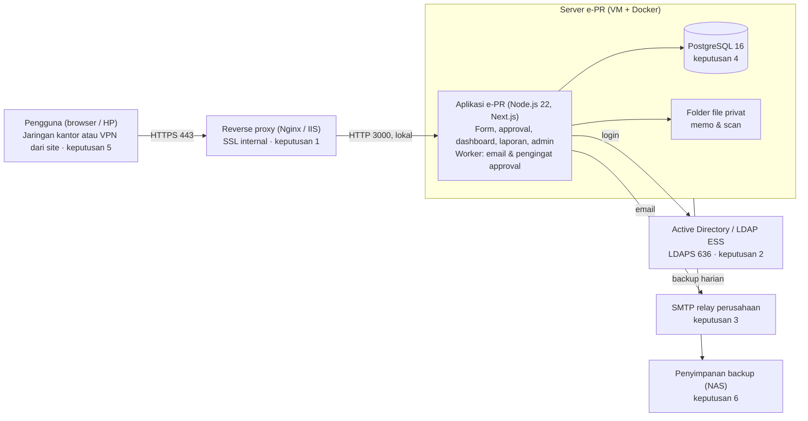

# Rapat Koordinasi IT — Go-Live e-PR

19 November 2026 · Learning & OD (HRD)

> Versi hidup dokumen ini (bisa diedit & dikomentari): https://claude.ai/artifact/2NpCJVFPwce5BagwPWL9Bs · Detail teknis: [DEPLOYMENT.md](./DEPLOYMENT.md), [GO-LIVE.md](./GO-LIVE.md)

Aplikasi e-PR (Personnel Request) sudah selesai dibangun dan diuji; untuk dipasang di server internal, kami butuh 7 keputusan teknis dari IT. Semua keputusan cukup diterapkan lewat konfigurasi, tanpa mengubah kode.

## Arsitektur

Hanya port 443 yang dibuka untuk pengguna; aplikasi hanya terhubung keluar ke AD/LDAP dan SMTP relay internal.

## Keputusan yang dibutuhkan dari IT

Urutan sesuai prioritas: nomor 1–3 menentukan apakah aplikasi bisa dipasang; 4–7 bisa menyusul.

| # | Topik | Pertanyaan untuk IT | Usulan kami | Bila belum diputuskan | Status (diisi saat rapat) |
| --- | --- | --- | --- | --- | --- |
| 1 | Server & hosting | VM Linux + Docker atau Windows Server? Nama DNS, sertifikat SSL internal, reverse proxy yang dipakai? | VM Linux + Docker Compose, nama `epr.<domain>.local`, HTTPS lewat Nginx/IIS | Aplikasi tidak bisa dipasang |  |
| 2 | Login ESS | Apakah ESS memakai Active Directory/LDAP? Host & port, base DN, username = NIK atau NIK di atribut lain (mis. `employeeID`)? Ada akun layanan read-only? Bila hanya API/SSO, mohon dokumentasinya | LDAPS (port 636), password tetap di AD, tidak disimpan di e-PR | Login memakai password e-PR terpisah yang direset Admin HR |  |
| 3 | Email | Host & port SMTP relay, perlu login atau tidak, TLS, alamat pengirim? IP server e-PR perlu didaftarkan di relay? | Relay internal, pengirim `epr-noreply@<domain>` | Notifikasi hanya tampil di aplikasi, tidak ada email |  |
| 4 | Database | PostgreSQL di dalam container atau server PostgreSQL milik IT? | Container di VM yang sama (paling sederhana) | Memakai container |  |
| 5 | Akses dari site/workshop | Apakah pengguna di site bisa menjangkau jaringan kantor (VPN/MPLS)? Perlu akses dari internet? | Lewat VPN/MPLS, tanpa dibuka ke internet | Pemohon di site tidak bisa mengakses |  |
| 6 | Backup & monitoring | Lokasi backup terpisah, jadwal, dan alat monitoring yang dipakai? | Backup harian 01.15, retensi 30 hari, salinan di NAS; pantau `/api/health` | Risiko kehilangan data |  |
| 7 | Data karyawan | Format ekspor master karyawan dari HRIS (kolom & nama Job Level)? Bisa dijadwalkan rutin? | Ekspor Excel sesuai template e-PR, diimpor Admin HR | Impor manual memakai template |  |

## Kebutuhan server minimum

Satu VM cukup untuk aplikasi dan database, untuk perkiraan ±500 pengguna.

| Komponen | Kebutuhan |
| --- | --- |
| CPU / RAM | 2 vCPU / 4 GB |
| Disk | 40 GB + ruang backup |
| Software | Docker Engine + Docker Compose, atau Node.js 22 + PostgreSQL 16 |
| Port masuk | 443 (HTTPS) dari jaringan kantor dan VPN; port aplikasi 3000 cukup lokal |
| Koneksi keluar | Hanya ke SMTP relay dan server AD/LDAP internal; tidak perlu internet saat berjalan |

## Keamanan & data

Seluruh data tersimpan di server internal; aplikasi tidak memakai layanan cloud, CDN, atau font dari internet.

- **Login:** mode LDAP memverifikasi password ke AD dan tidak menyimpannya. Akun terkunci 15 menit setelah 5 kali gagal, dan sesi lama batal saat password diganti, di-reset, atau akun dinonaktifkan.
- **Hak akses:** dicek di server per peran. Pengguna tidak bisa membuka PR atau memo divisi lain.
- **File memo & scan:** disimpan di folder privat (bukan folder publik), maks. 5 MB, isi file diverifikasi benar-benar PDF/JPG.
- **Audit trail:** perubahan status PR, data rekrutmen, master data, konfigurasi, dan aktivitas login tercatat (siapa & kapan).
- **Backup:** skrip backup harian dan restore sudah tersedia dan teruji; perlu diuji ulang di server IT sebelum go-live.
- **UU PDP:** masa retensi data PR & kandidat serta siapa yang boleh mengakses database perlu diputuskan bersama DPO/Legal.

## Langkah setelah rapat

Urutan menuju go-live; nama PIC dan tanggal target diisi saat rapat.

- [ ] IT: siapkan VM, DNS, sertifikat SSL, dan reverse proxy
- [ ] IT: isi konfigurasi production (login, email, database, secret) dan pasang aplikasi
- [ ] IT + HRD: buat akun Admin HR pertama, lalu cek panel "Kesiapan production" dan kirim email uji
- [ ] HRD: impor master karyawan dari HRIS, atur peran, Kadiv & Direktur pembina, matriks approval, hari libur
- [ ] IT: jadwalkan backup harian dan uji restore ke server uji
- [ ] HRD + perwakilan pengguna: UAT 9 skenario (pengajuan dari HP di site, approval lewat email, hold/filled, approval kertas, laporan, hak akses, penguncian akun)
- [ ] HRD: sosialisasi pengguna, lalu go-live dengan PR kertas berjalan paralel 2–4 minggu
